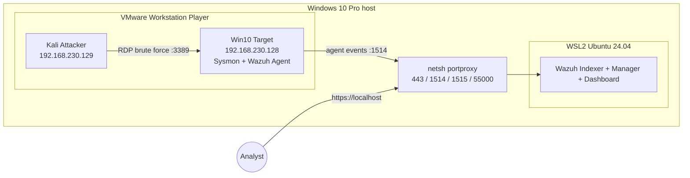

# SOC Home Lab


A hands-on **blue team** SOC lab: deploy a SIEM, collect telemetry from a Windows target, attack it from Kali, write detections, and document investigations.

## Overview

This repository documents a home SOC lab built on a single workstation. A Wazuh SIEM runs in WSL2, a Windows 10 target streams Sysmon and Security telemetry to it, and a Kali machine generates attacks. Each attack scenario ends with a Wazuh detection and a written investigation.

## Goals

- Practice the full cycle: **attack → telemetry → detection → investigation → lessons learned**.
- Build a portfolio of detections (Wazuh rules) and incident write-ups in a format close to real SOC work.
- Map every observed TTP to [MITRE ATT&CK](https://attack.mitre.org/).

## Architecture



Details: [docs/architecture.md](docs/architecture.md).

## Tech Stack

| Layer | Component | Version |
|-------|-----------|---------|
| SIEM | Wazuh (Indexer, Manager, Dashboard) | 4.9.2 |
| SIEM platform | WSL2, Ubuntu | 24.04 |
| Telemetry | Sysmon + SwiftOnSecurity config | 15.22 |
| Telemetry | Wazuh Agent | 4.9.2 |
| Hypervisor | VMware Workstation Player | 17.6.3 |
| Target | Windows 10 Pro | 22H2 |
| Attacker | Kali Linux | 2026.1 |

Full list with links: [docs/tools.md](docs/tools.md).

## Progress

- [x] Wazuh 4.9.2 deployed in WSL2 (Ubuntu 24.04, systemd enabled)
- [x] WSL2 resource limits via `.wslconfig` (8 GB RAM, 4 CPUs, swap on a dedicated disk)
- [x] Host-to-WSL port forwarding automated ([scripts/update-portproxy.ps1](scripts/update-portproxy.ps1))
- [x] VMware Workstation Player, isolated VMnet1 network (Host-Only)
- [x] Windows 10 Target: Sysmon + SwiftOnSecurity, Wazuh Agent, PowerShell Script Block Logging, Defender
- [x] RDP enabled on the Target (3389)
- [x] Kali Attacker deployed
- [x] First detection: [detections/rdp-brute-force.xml](detections/rdp-brute-force.xml)
- [x] First investigation: [investigations/rdp-brute-force.md](investigations/rdp-brute-force.md)
- [x] Second detection: [detections/powershell-execution.xml](detections/powershell-execution.xml)
- [x] Second investigation: [investigations/powershell-execution.md](investigations/powershell-execution.md)
- [x] Third detection: [detections/scheduled-task-persistence.xml](detections/scheduled-task-persistence.xml)
- [x] Third investigation: [investigations/scheduled-task-persistence.md](investigations/scheduled-task-persistence.md)
- [x] Fourth detection: [detections/lsass-credential-dumping.xml](detections/lsass-credential-dumping.xml)
- [x] Fourth investigation: [investigations/lsass-credential-dumping.md](investigations/lsass-credential-dumping.md)

## Detections and Investigations

| Scenario | Detection | Investigation | ATT&CK |
|----------|-----------|---------------|--------|
| RDP brute force | [rdp-brute-force.xml](detections/rdp-brute-force.xml) | [rdp-brute-force.md](investigations/rdp-brute-force.md) | T1110, T1110.001 |
| PowerShell execution | [powershell-execution.xml](detections/powershell-execution.xml) | [powershell-execution.md](investigations/powershell-execution.md) | T1059.001 |
| Scheduled task persistence | [scheduled-task-persistence.xml](detections/scheduled-task-persistence.xml) | [scheduled-task-persistence.md](investigations/scheduled-task-persistence.md) | T1053.005 |
| LSASS credential dumping | [lsass-credential-dumping.xml](detections/lsass-credential-dumping.xml) | [lsass-credential-dumping.md](investigations/lsass-credential-dumping.md) | T1003.001 |

## MITRE ATT&CK Mapping

| Technique | ID | Scenario | Detection rule |
|-----------|----|----------|----------------|
| Brute Force: Password Guessing | [T1110.001](https://attack.mitre.org/techniques/T1110/001/) | RDP brute force> **Note:** Rule 100001 (frequency-based) enriches the built-in rule 60122 with accurate MITRE mapping for brute force (T1110.001) and explicitly categorizes the alert as credential_access.
| Command and Scripting Interpreter: PowerShell | [T1059.001](https://attack.mitre.org/techniques/T1059/001/) | PowerShell execution | 100002 |
| Scheduled Task/Job: Scheduled Task | [T1053.005](https://attack.mitre.org/techniques/T1053/005/) | Scheduled task persistence | 100003 |
| OS Credential Dumping: LSASS Memory | [T1003.001](https://attack.mitre.org/techniques/T1003/001/) | LSASS credential dumping | 100004 |

## Repository Structure

soc-home-lab/
├── README.md
├── LICENSE
├── docs/
│   ├── architecture.md
│   └── tools.md
├── detections/
│   ├── rdp-brute-force.xml
│   └── powershell-execution.xml
├── investigations/
│   ├── rdp-brute-force.md
│   └── powershell-execution.md
├── screenshots/
└── scripts/
    └── update-portproxy.ps1

## Getting Started

1. **SIEM.** In WSL2 (Ubuntu 24.04) install Wazuh 4.9 using the official quickstart:
```bash
   curl -sO https://packages.wazuh.com/4.9/wazuh-install.sh
   sudo bash ./wazuh-install.sh -a
```
2. **Port forwarding.** On the Windows host, run [scripts/update-portproxy.ps1](scripts/update-portproxy.ps1) as Administrator (re-run it after every WSL restart).
3. **Target.** On the Windows 10 VM install Sysmon with the SwiftOnSecurity config:
```powershell
   sysmon64.exe -accepteula -i sysmonconfig.xml
```
   Install the Wazuh Agent with `WAZUH_MANAGER` set to the host IP on VMnet1 (`192.168.230.1`).
4. **Detections.** Copy files from [detections/](detections/) to `/var/ossec/etc/rules/` on the Wazuh Manager and restart it:
```bash
   sudo systemctl restart wazuh-manager
```
5. **Attack.** Run the scenario from Kali and compare the alerts with the matching file in [investigations/](investigations/).

See [docs/architecture.md](docs/architecture.md) for the network layout and resource limits.

## Lessons Learned

- The WSL2 IP changes on every restart, so static port forwarding breaks silently. Recreating the `netsh portproxy` rules with a script fixed it.
- `networkingMode=mirrored` is not available on Windows 10, so NAT plus portproxy is the only way for VMs to reach Wazuh inside WSL2.
- With 16 GB of RAM the lab has almost no headroom; VMs have to be started selectively.

## Roadmap

- [ ] Atomic Red Team integration for reproducible tests
- [ ] Convert rules to Sigma format
- [ ] Add a Linux target with a Wazuh agent
- [ ] Active Response: block the source of a brute-force attack
- [ ] Wazuh dashboards for lab scenarios

## Lab Safety

- The VMnet1 network is isolated (Host-Only); the targets have no outbound access through this segment.
- All passwords and secrets in this repository are replaced with `<REDACTED>`.
- Attacks are performed **only** against my own virtual machines.

## License

This project is licensed under the [MIT License](LICENSE).
