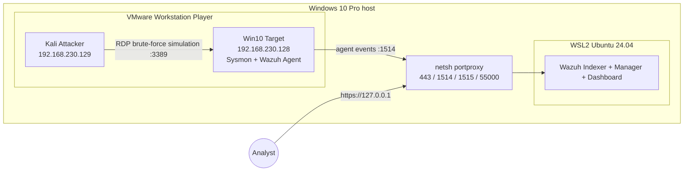

# SOC Home Lab


A hands-on **blue team** SOC lab: deploy a SIEM, collect telemetry from a Windows target, simulate attacks from Kali, build detections, and document investigations.

## Overview

This repository documents a home SOC lab built on a single workstation. Wazuh SIEM runs in WSL2, a Windows 10 target forwards Sysmon and Windows Security telemetry to it, and a Kali Linux VM generates controlled attack simulations. Each scenario is documented with the corresponding detection, investigation findings, and lessons learned.

## Goals

- Practice the full cycle: **attack simulation → telemetry → detection → investigation → lessons learned**.
- Build a portfolio of Wazuh detection rules and investigation write-ups in a format close to real SOC workflows.
- Map observed tactics, techniques, and procedures (TTPs) to [MITRE ATT&CK](https://attack.mitre.org/).
- Practice the SOC Analyst L1 workflow: triage alerts, validate evidence, distinguish true positives from false positives, and escalate when needed.

## Architecture



Details: [docs/architecture.md](docs/architecture.md).

## Tech Stack

| Layer | Component | Version |
|-------|-----------|---------|
| SIEM | Wazuh (Indexer, Manager, Dashboard) | 4.9.2 |
| SIEM platform | WSL2, Ubuntu | 24.04 |
| Telemetry | Sysmon + SwiftOnSecurity config | 15.22 |
| Telemetry | Wazuh Agent | 4.9.2 |
| Hypervisor | VMware Workstation Player | 17.6.3 |
| Target | Windows 10 Pro | 22H2 |
| Attacker | Kali Linux | 2026.1 |

Full list with links: [docs/tools.md](docs/tools.md).

## Progress

- [x] Wazuh 4.9.2 deployed in WSL2 (Ubuntu 24.04, systemd enabled)
- [x] WSL2 resource limits configured via `.wslconfig` (8 GB RAM, 4 CPUs, swap on a dedicated disk)
- [x] Host-to-WSL port forwarding automated ([scripts/update-portproxy.ps1](scripts/update-portproxy.ps1))
- [x] Automated startup script added ([scripts/start-wazuh.ps1](scripts/start-wazuh.ps1)) for starting Wazuh services
- [x] VMware Workstation Player configured with an isolated VMnet1 (Host-Only) network
- [x] Windows 10 target configured with Sysmon + SwiftOnSecurity, Wazuh Agent, PowerShell Script Block Logging, and Microsoft Defender
- [x] RDP enabled on the target (3389)
- [x] Kali Linux attacker VM deployed
- [x] First detection: [detections/rdp-brute-force.xml](detections/rdp-brute-force.xml)
- [x] First investigation: [investigations/rdp-brute-force.md](investigations/rdp-brute-force.md)
- [x] Second detection: [detections/powershell-execution.xml](detections/powershell-execution.xml)
- [x] Second investigation: [investigations/powershell-execution.md](investigations/powershell-execution.md)
- [x] Third detection: [detections/scheduled-task-persistence.xml](detections/scheduled-task-persistence.xml)
- [x] Third investigation: [investigations/scheduled-task-persistence.md](investigations/scheduled-task-persistence.md)
- [x] Fourth detection: [detections/lsass-credential-dumping.xml](detections/lsass-credential-dumping.xml)
- [x] Fourth investigation: [investigations/lsass-credential-dumping.md](investigations/lsass-credential-dumping.md)

## Detections and Investigations

| Scenario | Detection | Investigation | ATT&CK |
|----------|-----------|---------------|--------|
| RDP brute force | [rdp-brute-force.xml](detections/rdp-brute-force.xml) | [rdp-brute-force.md](investigations/rdp-brute-force.md) | T1110, T1110.001 |
| PowerShell execution | [powershell-execution.xml](detections/powershell-execution.xml) | [powershell-execution.md](investigations/powershell-execution.md) | T1059.001 |
| Scheduled task persistence | [scheduled-task-persistence.xml](detections/scheduled-task-persistence.xml) | [scheduled-task-persistence.md](investigations/scheduled-task-persistence.md) | T1053.005 |
| LSASS credential dumping | [lsass-credential-dumping.xml](detections/lsass-credential-dumping.xml) | [investigations/lsass-credential-dumping.md](investigations/lsass-credential-dumping.md) | T1003.001 |

## MITRE ATT&CK Mapping

| Technique | ID | Scenario | Detection rule |
|-----------|----|----------|----------------|
| Brute Force: Password Guessing | [T1110.001](https://attack.mitre.org/techniques/T1110/001/) | RDP brute force | 100001 |
| Command and Scripting Interpreter: PowerShell | [T1059.001](https://attack.mitre.org/techniques/T1059/001/) | PowerShell execution | 100002 |
| Scheduled Task/Job: Scheduled Task | [T1053.005](https://attack.mitre.org/techniques/T1053/005/) | Scheduled task persistence | 100003 |
| OS Credential Dumping: LSASS Memory | [T1003.001](https://attack.mitre.org/techniques/T1003/001/) | LSASS credential dumping | 100004 |

> **Note:** Rule `100001` uses frequency-based matching to enrich built-in rule `60122` with MITRE ATT&CK mapping for brute force (`T1110.001`) and categorizes the alert as `credential_access`.

## Repository Structure

```text
soc-home-lab/
├── README.md
├── LICENSE
├── docs/
│   ├── architecture.md
│   └── tools.md
├── detections/
│   ├── rdp-brute-force.xml
│   ├── powershell-execution.xml
│   ├── scheduled-task-persistence.xml
│   └── lsass-credential-dumping.xml
├── investigations/
│   ├── rdp-brute-force.md
│   ├── powershell-execution.md
│   ├── scheduled-task-persistence.md
│   └── lsass-credential-dumping.md
├── screenshots/
└── scripts/
    ├── start-wazuh.ps1
    └── update-portproxy.ps1
```

## Getting Started

### Automated Startup (Recommended)

A PowerShell script is provided to simplify starting the lab infrastructure after a reboot.

1. Open PowerShell as Administrator.
2. Navigate to the repository's `scripts/` directory.
3. Run:

   ```powershell
   .\start-wazuh.ps1
   ```

**What it does:**

- Checks WSL2 availability.
- Starts Wazuh Indexer and waits for it to become ready (green/yellow status).
- Starts Wazuh Manager and Dashboard.
- Updates the `netsh portproxy` rules with the current WSL2 IP by calling `update-portproxy.ps1`.
- Opens the Wazuh Dashboard in your default browser.

> **Note:** The script currently assumes the repository is located at `D:\SOC-Lab\`. If you cloned it elsewhere, update the hardcoded path to `update-portproxy.ps1` inside `start-wazuh.ps1` before running it.

### Manual Setup

1. **SIEM.** In WSL2 (Ubuntu 24.04), install Wazuh 4.9 using the official quickstart:

   ```bash
   curl -sO https://packages.wazuh.com/4.9/wazuh-install.sh
   sudo bash ./wazuh-install.sh -a
   ```

2. **Port forwarding.** On the Windows host, run `scripts/update-portproxy.ps1` as Administrator. Run it again after each WSL restart because the WSL2 IP may change.

   > Ensure Windows Firewall allows inbound TCP connections on ports `1514`, `1515`, `55000`, and `443` from the VMnet1 subnet (`192.168.230.0/24`) so the VMs can reach Wazuh.

3. **Target.** On the Windows 10 VM, install Sysmon with the SwiftOnSecurity configuration:

   ```powershell
   sysmon64.exe -accepteula -i sysmonconfig.xml
   ```

   Install the Wazuh Agent and set `WAZUH_MANAGER` to the host's VMnet1 IP address (`192.168.230.1`).

4. **Detections.** Copy the XML files from `detections/` to `/var/ossec/etc/rules/` on the Wazuh Manager, then restart the manager:

   ```bash
   sudo systemctl restart wazuh-manager
   ```

5. **Attack simulation and investigation.** Run the relevant controlled scenario from Kali and compare the resulting alerts with the matching write-up in `investigations/`.

See [docs/architecture.md](docs/architecture.md) for the network layout and resource limits.

## Lessons Learned

- The WSL2 IP changes after a restart, which can silently break static port-forwarding rules. Updating the `netsh portproxy` rules with a script solved this problem.
- `networkingMode=mirrored` is not available in this Windows 10 setup, so NAT plus `netsh portproxy` is used to let the VMs reach Wazuh inside WSL2.
- With 16 GB of RAM, there is little headroom when running the full lab. VMs need to be started selectively; 32 GB is recommended if you want to run all VMs simultaneously.
- LLM-based assistants helped accelerate infrastructure setup and draft rule syntax. This left more time for investigation logic, detection tuning, and MITRE ATT&CK mapping.

## Roadmap

- [ ] Integrate Atomic Red Team for reproducible tests
- [ ] Convert Wazuh rules to Sigma format
- [ ] Add a Linux target with a Wazuh Agent
- [ ] Configure Active Response to block the source of a brute-force simulation
- [ ] Build Wazuh dashboards for lab scenarios

## Lab Safety

- The VMnet1 network is isolated (Host-Only); targets have no outbound access through this segment.
- Passwords and secrets in this repository are replaced with `<REDACTED>`.
- Attack simulations are performed **only** against my own virtual machines.

## License

This project is licensed under the [MIT License](LICENSE).
