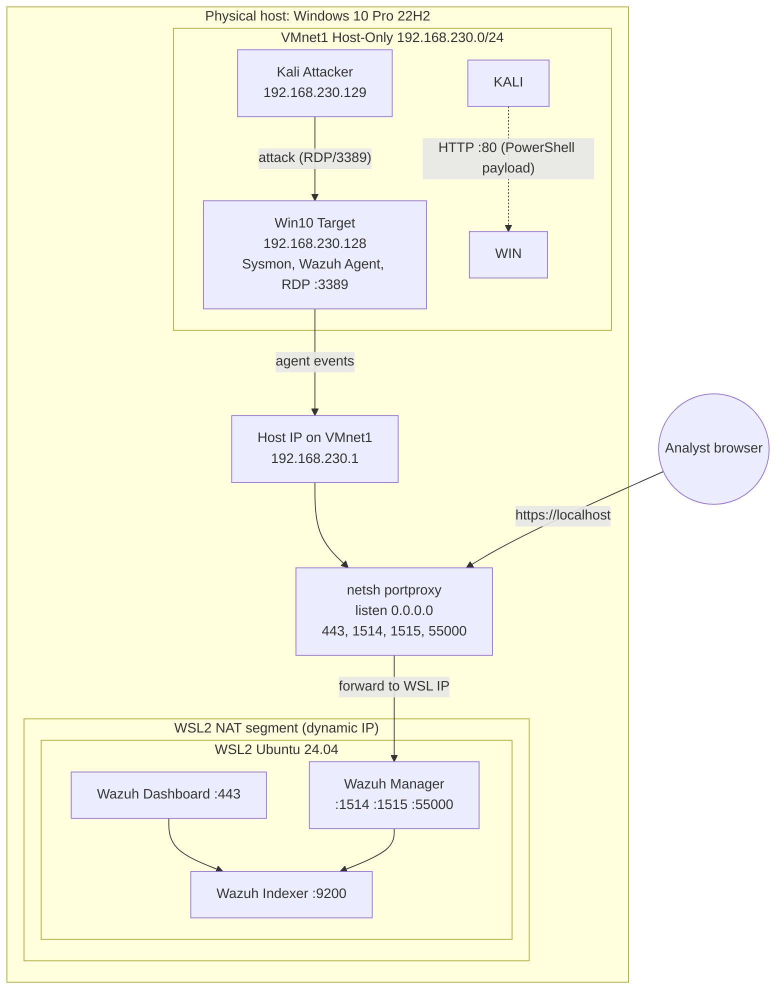
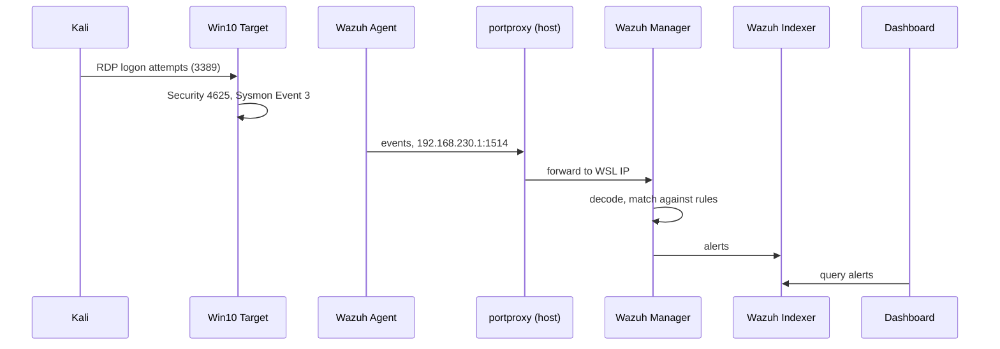

# Lab Architecture

## 1. Overview

## 2. Network Segments

| Segment | Type | Addressing | Members |
|---------|------|------------|---------|
| Host LAN | Physical network | DHCP from the home network | Windows host |
| WSL2 | NAT (WSL virtual switch) | Dynamic IP, changes on every WSL restart | Ubuntu 24.04 running the Wazuh stack |
| VMnet1 | VMware Host-Only | 192.168.230.0/24 | Host (.1), Win10 Target (.128), Kali (.x) |

## 3. Hosts and Roles

| Host | Role | Address | Resources | OS |
|------|------|---------|-----------|----|
| DESKTOP-HOST | Hypervisor, port relay | 192.168.230.1 (VMnet1) | 4C/8T, 16 GB | Windows 10 Pro 22H2 |
| WSL2 | Wazuh Indexer + Manager + Dashboard | dynamic | up to 8 GB, 4 CPUs | Ubuntu 24.04 |
| Win10 Target | Victim, telemetry source | 192.168.230.128 | 4 GB, 2 CPUs, 60 GB | Windows 10 Pro 22H2 |
| Kali Attacker | Attack generation | 192.168.230.x | 2 GB, 2 CPUs | Kali 2026.1 |

## 4. Data Flows

| # | Source | Destination | Port / Protocol | Purpose |
|---|--------|-------------|-----------------|---------|
| 1 | Wazuh Agent (Target) | 192.168.230.1 (host) → portproxy → Manager | 1514 TCP | Event delivery |
| 2 | Wazuh Agent (Target) | 192.168.230.1 → portproxy → Manager | 1515 TCP | Agent enrollment |
| 3 | Analyst (host browser) | localhost → portproxy → Dashboard | 443 TCP | Web UI |
| 4 | API clients | host → portproxy → Manager | 55000 TCP | Wazuh API |
| 5 | Dashboard / Manager | Indexer (inside WSL) | 9200 TCP | Indexing and search |
| 6 | Kali | Win10 Target | 3389 TCP | Attack scenario: RDP brute force |

Port 9200 is not forwarded outside: the Indexer is reachable only inside WSL2.

### Event Path

## 5. RAM Budget

Host: 16 GB (about 15.9 GB available).

| Consumer | Limit, GB | Notes |
|----------|-----------|-------|
| WSL2 (Wazuh) | 8.0 | Hard limit in `.wslconfig` |
| Win10 Target | 4.0 | Allocated in VMware |
| Kali Attacker | 2.0 | Started only when needed |
| Windows host and VMware | ~1.9 | Remainder |
| **Total** | **~15.9** | Practically no headroom |

Recommendations:

- Start Kali only for the duration of an attack.
- Avoid heavy applications on the host while all VMs are running.
- WSL2 swap is placed on a separate SSD to avoid loading the system disk.

## 6. Disk Layout

| Purpose | Type | Contents |
|---------|------|----------|
| System SSD | SSD | Host OS |
| Lab SSD | SSD | WSL2 disk, VMs, WSL swap, logs |
| HDD | HDD | ISO images, backups |

## 7. WSL2 NAT Mode Limitations

| Limitation | Consequence | Mitigation in this lab |
|------------|-------------|------------------------|
| The WSL2 IP changes on every restart | Old forwarding rules stop working | [scripts/update-portproxy.ps1](../scripts/update-portproxy.ps1) recreates the rules |
| VMs on VMnet1 cannot reach the WSL2 network directly | The agent cannot contact the Manager by WSL IP | The host acts as a relay: the agent connects to 192.168.230.1 |
| `networkingMode=mirrored` is not available on Windows 10 | No shared network namespace with the host | NAT + portproxy is used |
| `netsh portproxy` supports TCP only | UDP syslog (514) cannot be forwarded | Only TCP 1514 is used |
| Windows Firewall may block inbound traffic on the host | The agent cannot reach forwarded ports | Allow inbound TCP 1514/1515 for the VMnet1 profile |
| portproxy rules survive reboots, the WSL IP does not | Silent failure after a restart | Run the script after every WSL start (for example, via Task Scheduler) |
| Resource limits are global | WSL2 could consume host memory | `.wslconfig`: 8 GB RAM, 4 CPUs |

## 8. Operations

1. Start WSL2 and make sure the Wazuh services are active.
2. Run `scripts/update-portproxy.ps1` as Administrator.
3. Check the Dashboard at `https://localhost`.
4. Start the Win10 Target and verify the agent status is *Active*.
5. Start Kali if needed.
